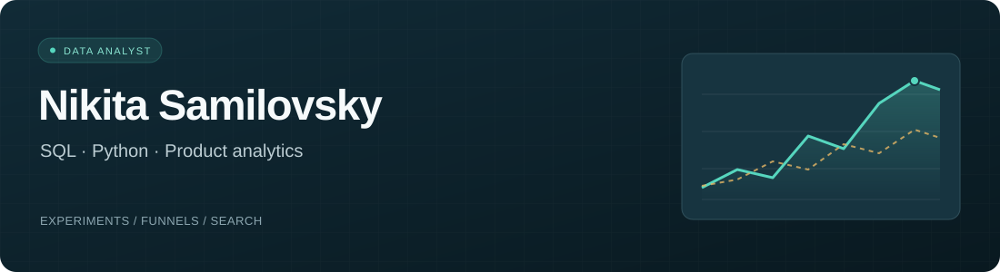
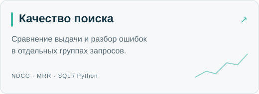
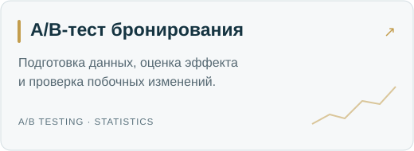
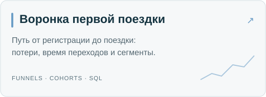
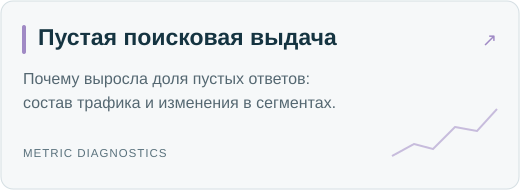
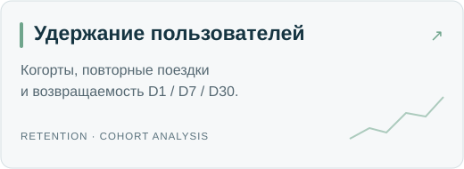
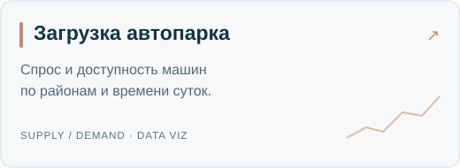

  

  <a href="https://t.me/neo_ybt">Telegram</a> &nbsp; · &nbsp;
  <a href="mailto:nikitasamilovsky@gmail.com">Email</a> &nbsp; · &nbsp;
  <a href="https://github.com/Winlak?tab=repositories">Все репозитории</a>

### Обо мне

Я Никита, стажёр-аналитик в Яндексе и студент второго курса ПМИ НИУ ВШЭ.
До этого три месяца работал Junior ML Engineer. Пишу на Python и SQL, разбираю
продуктовые метрики и экспериментальные данные.

Здесь собраны мои проекты по A/B-тестам, воронкам, удержанию и качеству поиска.
В каждом есть код расчётов, описание данных и отчёт с результатами.

### Инструменты

  
  
  
  
  
  
  
  
  
  

**Что делаю:** готовлю выборки и витрины, проверяю данные, считаю метрики,
сравниваю группы и ищу причины изменений. Работаю с воронками, когортами,
доверительными интервалами и поисковыми метриками.

### Проекты

  
  

  
  

  
  

Это учебные исследования на сгенерированных данных. Генераторы и правила
расчёта открыты; результаты относятся к этим наборам данных.
